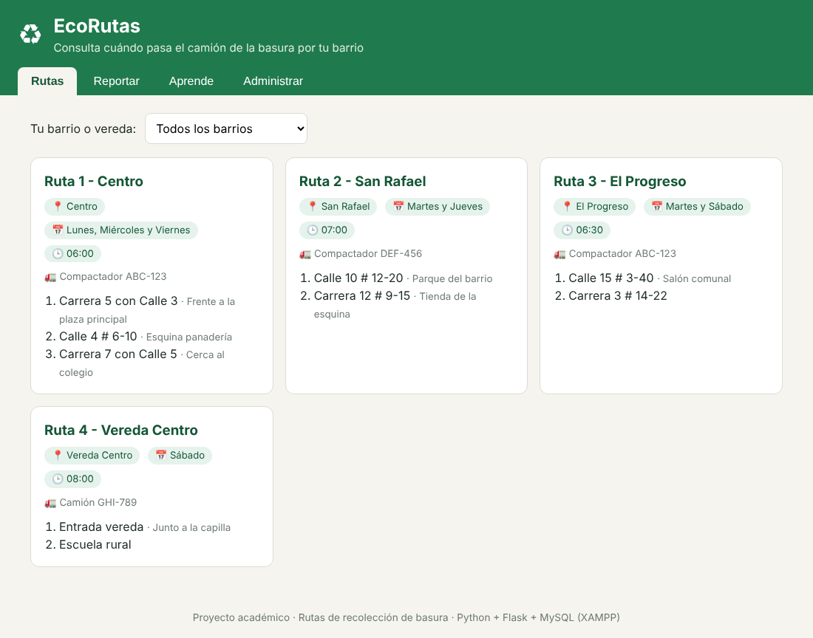
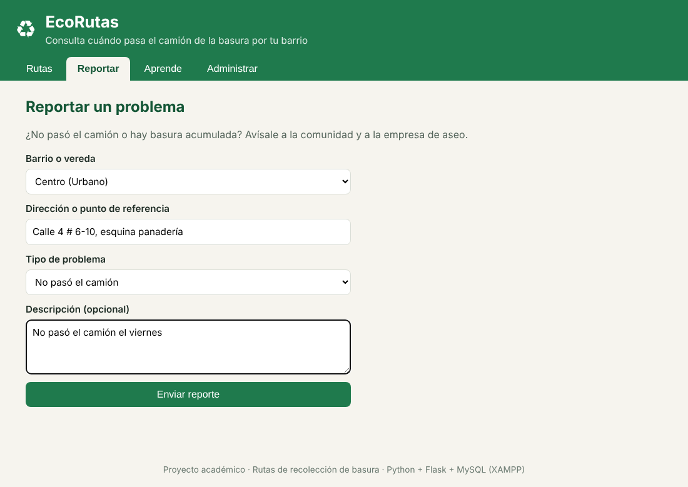
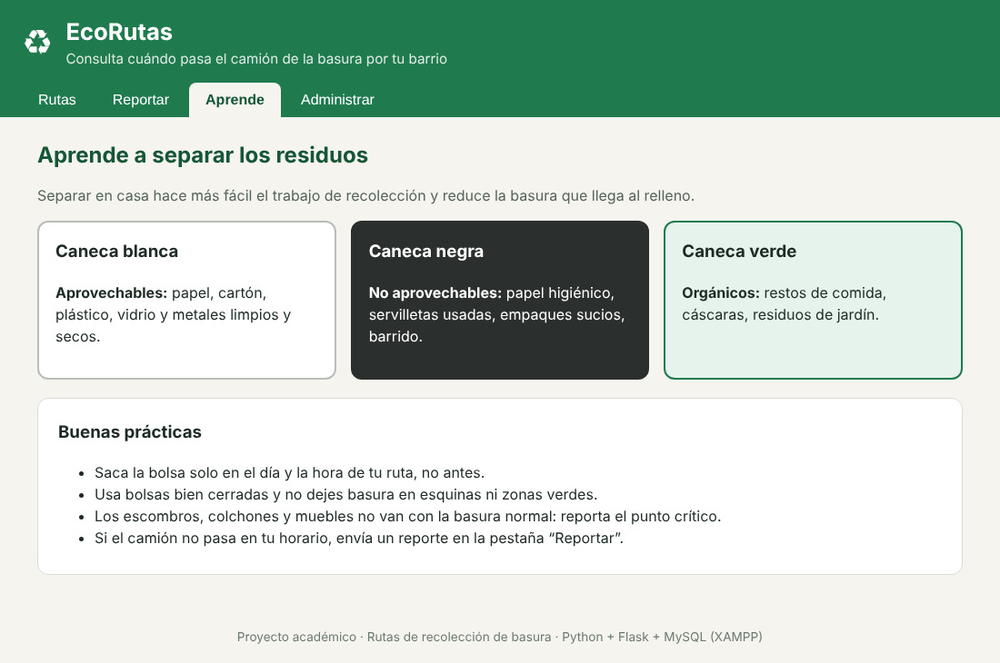
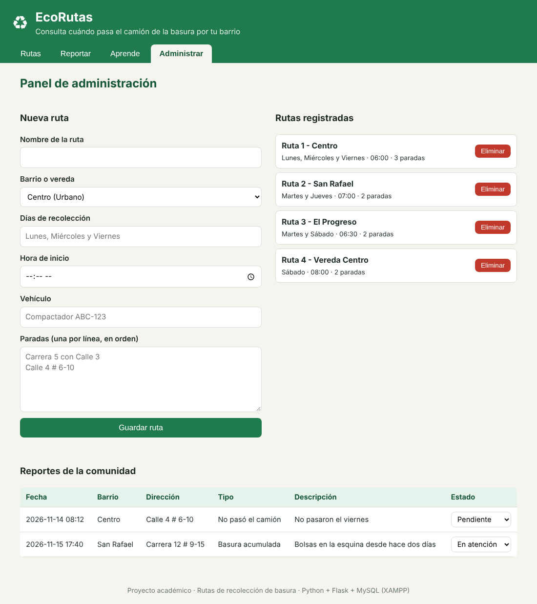
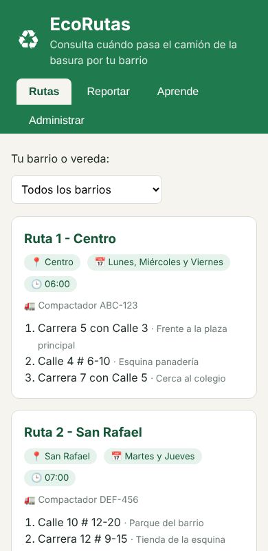

# Interfaces de EcoRutas

La interfaz es una página web de una sola pantalla con cuatro pestañas. El código vive en
[`../web/`](../web) (`index.html`, `css/estilos.css`, `js/app.js`); esta carpeta documenta cómo se ve
cada pantalla. Las capturas se tomaron con la aplicación en funcionamiento y datos de ejemplo.

| # | Pantalla | Quién la usa | Qué permite | Captura |
|---|----------|--------------|-------------|---------|
| 1 | **Rutas** | Ciudadano | Elegir su barrio o vereda y ver días, hora, vehículo y paradas (en orden) de cada ruta | `01-rutas.png` |
| 2 | **Reportar** | Ciudadano | Avisar que no pasó el camión, hay basura acumulada o un punto crítico | `02-reportar.png` |
| 3 | **Aprende** | Ciudadano | Guía de canecas (blanca, negra, verde) y buenas prácticas | `03-aprende.png` |
| 4 | **Administrar** | Empresa de aseo | Crear/eliminar rutas con sus paradas y cambiar el estado de los reportes | `04-administrar.png` |
| 5 | **Rutas (móvil)** | Ciudadano | La misma pantalla 1 en un celular (diseño adaptable) | `05-rutas-movil.png` |

## 1. Rutas

## 2. Reportar

## 3. Aprende

## 4. Administrar

## 5. Vista en celular

